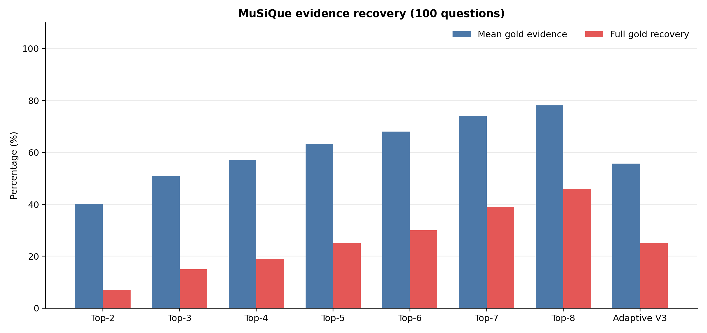
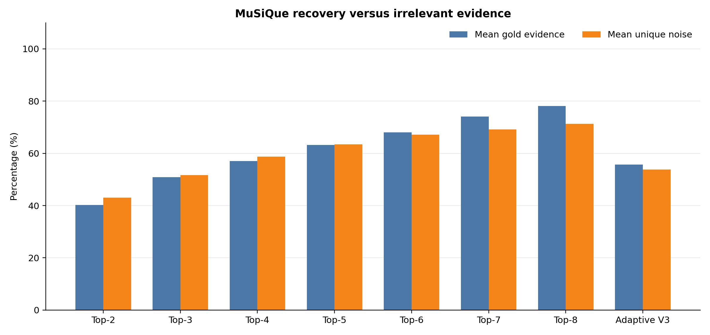
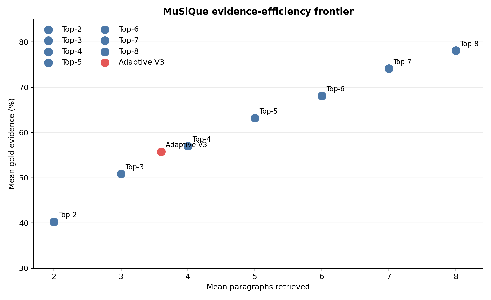
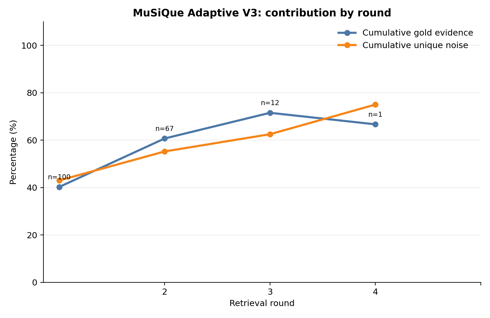
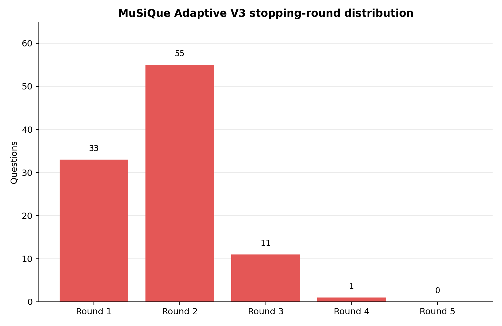
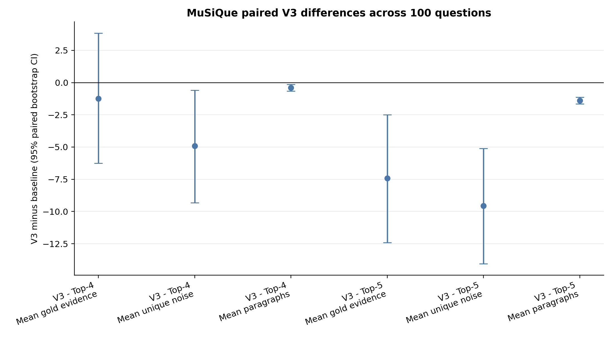

# Adaptive RAG on MuSiQue: 100-question analysis report

## Executive summary

This study evaluates Adaptive V3 on 100 MuSiQue multi-hop questions against
fixed Top-2 through Top-8 retrieval baselines. MuSiQue is more demanding than
the HotpotQA experiment because its questions require longer reasoning chains,
so a larger fixed retrieval depth is needed to recover more annotated evidence.

On this 100-question sample, Adaptive V3 retrieves fewer paragraphs and less
irrelevant evidence than Top-4 and Top-5, but it does not match their evidence
recovery:

- V3: **55.75% mean gold evidence**, **25.0% full recovery**
- Top-4: **57.0% mean gold evidence**, **19.0% full recovery**
- Top-5: **63.17% mean gold evidence**, **25.0% full recovery**
- V3: **3.60 mean paragraphs** and **53.83% mean noise**
- Top-5: **5.00 mean paragraphs** and **63.40% mean noise**

The main MuSiQue finding is therefore more nuanced than the HotpotQA result:
Adaptive V3 provides an efficiency benefit, but its adaptive budget is
insufficient to recover as much evidence as deeper fixed retrieval on this
harder dataset. V3 has a particularly severe stopping limitation: **96 of 100
runs (96.0%) ended through repeated-query detection**, and only four ended
with an explicit sufficient decision.

## 1. Scope and dataset

The analysis uses the completed MuSiQue runs under
[`outputs/Musique/`](../../outputs/Musique/). There are eight systems, all
evaluated on the same 100 questions:

- Fixed Top-2 through Top-8.
- Adaptive V3.

There are no MuSiQue V1 or V2.1 output folders, so this report does not
present V1/V2.1 results. The source metadata identifies the MuSiQue train
corpus from `voidful/MuSiQue`; the output records contain the question-scoped
candidate paragraphs and annotated gold paragraph IDs.

This is a paragraph-retrieval analysis. It measures evidence recovery,
irrelevant evidence, and retrieval cost; it does not measure final answer
accuracy.

## 2. Architecture

The systems share the same retrieval foundation:

```text
MuSiQue question and candidate paragraphs
        |
        v
MiniLM embeddings + cosine ranking
        |
        +--> Fixed baseline: return Top-k once
        |
        +--> Adaptive V3: return Top-2 unseen paragraphs
                                  |
                                  v
                        Qwen3-4B sufficiency controller
                           |                 |
                      sufficient        new query
                           |                 |
                           v                 v
                         stop       retrieve another Top-2
                                           |
                                           v
                              accumulate unique evidence
                              and repeat up to five rounds
```

### Fixed baselines

Each fixed baseline embeds the original question, ranks the question's
candidate paragraphs, and returns the first `k` paragraphs once. Top-2 to
Top-8 measure how retrieval depth affects evidence recovery and noise.

### Adaptive V3

V3 begins with Top-2 retrieval. The controller receives the original question
and all accumulated unique evidence. It returns only:

```json
{"search_query": null}
```

or:

```json
{"search_query": "targeted follow-up query"}
```

Python controls the loop. It skips already returned paragraph IDs, returns
the next two unseen paragraphs, preserves all accumulated unique evidence,
detects repeated queries, and bounds retrieval at five rounds. In this run,
the observed maximum was four rounds.

## 3. Metrics

For each question, let `G` be the annotated gold paragraph IDs, `U` the unique
retrieved paragraph IDs, and `R` the raw returned paragraph instances.

| Metric | Meaning | Preferred direction |
|---|---|---|
| Mean gold evidence | Average percentage of annotated gold paragraphs recovered | Higher |
| Full recovery | Percentage of questions with all gold paragraphs recovered | Higher |
| Zero recovery | Percentage with no gold paragraph recovered | Lower |
| Mean unique noise | Average percentage of unique retrieved paragraphs that are not gold | Lower |
| Mean paragraphs | Average raw paragraphs returned | Lower if recovery is maintained |
| Mean rounds | Average retrieval calls | Lower if recovery is maintained |
| Reasoning calls | Controller, repair, and query-regeneration calls | Lower if recovery is maintained |

Recovery and noise must be interpreted together. A deeper baseline can
increase recovery simply by adding more paragraphs, but this also tends to
increase irrelevant context.

## 4. Main 100-question results

| System | Mean gold evidence | Full recovery | Zero recovery | Mean noise | Mean paragraphs | Mean rounds |
|---|---:|---:|---:|---:|---:|---:|
| Top-2 | 40.25% | 7.0% | 15.0% | 43.00% | 2.00 | 1.00 |
| Top-3 | 50.83% | 15.0% | 10.0% | 51.67% | 3.00 | 1.00 |
| Top-4 | 57.00% | 19.0% | 9.0% | 58.75% | 4.00 | 1.00 |
| Top-5 | 63.17% | 25.0% | 5.0% | 63.40% | 5.00 | 1.00 |
| Top-6 | 68.08% | 30.0% | 3.0% | 67.17% | 6.00 | 1.00 |
| Top-7 | 74.08% | 39.0% | 2.0% | 69.14% | 7.00 | 1.00 |
| Top-8 | 78.08% | 46.0% | 2.0% | 71.25% | 8.00 | 1.00 |
| **Adaptive V3** | **55.75%** | **25.0%** | 12.0% | **53.83%** | **3.60** | **1.80** |

The fixed baselines show a strong retrieval-depth trade-off. Increasing `k`
from 2 to 8 raises mean gold recovery from 40.25% to 78.08% and full recovery
from 7.0% to 46.0%, but mean noise also rises from 43.00% to 71.25%.

V3 is more efficient than Top-4 and Top-5 in retrieval volume and noise:

- Versus Top-4, V3 uses **0.40 fewer paragraphs** and **4.92 percentage
  points less noise**, while mean recovery is **1.25 points lower**.
- Versus Top-5, V3 uses **1.40 fewer paragraphs** and **9.57 percentage
  points less noise**, while mean recovery is **7.42 points lower**.
- V3 matches Top-5's full-recovery rate of 25.0%, but has a higher
  zero-recovery rate: 12.0% versus 5.0%.

## 5. Figure-by-figure interpretation

### Figure 1: evidence recovery



This figure compares mean gold evidence and full recovery for all fixed
baselines and V3.

**Interpretation:** Fixed retrieval depth is highly valuable for MuSiQue.
Recovery increases steadily through Top-8. V3 reaches the Top-5 full-recovery
rate but has lower mean gold recovery than Top-5 and Top-6.

**Insight:** On this dataset, V3's current adaptive policy does not acquire
enough evidence to replace deeper fixed retrieval when maximizing recovery is
the primary objective.

### Figure 2: recovery versus irrelevant evidence



This figure compares useful evidence recovery with unique noise.

**Interpretation:** Fixed Top-k retrieval gains recovery but pays increasing
noise. V3 has lower noise than Top-4 and Top-5, but its recovery is also
lower than Top-5.

**Insight:** V3 offers a genuine efficiency trade-off, not a dominant result:
it reduces context and noise, but sacrifices some evidence recovery on
MuSiQue.

### Figure 3: evidence-efficiency frontier



The x-axis is mean paragraphs retrieved and the y-axis is mean gold evidence.
A desirable point is higher and further left.

**Interpretation:** The fixed baselines form an upward curve from Top-2 to
Top-8. V3 lies near the Top-4 budget but below Top-4 in mean recovery.

**Insight:** Unlike the HotpotQA result, V3 does not lie above the fixed
frontier on MuSiQue. This suggests that longer multi-hop questions need either
more adaptive rounds or better follow-up query generation.

### Figure 4: adaptive progress by round



| Round | Questions reaching round | Cumulative gold recovery | Cumulative noise |
|---:|---:|---:|---:|
| 1 | 100 | 40.25% | 43.00% |
| 2 | 67 | 60.70% | 55.22% |
| 3 | 12 | 71.53% | 62.50% |
| 4 | 1 | 66.67% | 75.00% |

**Interpretation:** The first follow-up round provides a substantial gain,
from 40.25% to 60.70% among the questions reaching Round 2. Later rounds have
very small sample sizes and introduce more noise.

**Insight:** Adaptive retrieval helps, but many MuSiQue questions need more
than the current controller successfully provides. The Round 3 population is
only 12 questions, and nearly all runs terminate before a fourth useful
round.

### Figure 5: stopping-round distribution



V3 stopping rounds are:

- Round 1: 33 questions.
- Round 2: 55 questions.
- Round 3: 11 questions.
- Round 4: 1 question.

**Interpretation:** 88 of 100 questions stop by Round 2. This explains the
low average of 1.80 retrieval rounds and 3.60 paragraphs.

**Insight:** The five-round maximum is not the main constraint in this run.
The controller usually stops earlier because it repeats a query, rather than
because it reaches the maximum round limit.

### Figure 6: paired bootstrap confidence intervals



The intervals use 10,000 paired resamples of the same 100 questions. Values
are V3 minus the fixed baseline.

| Comparison | Metric | Mean difference | 95% CI |
|---|---|---:|---:|
| V3 - Top-4 | Mean gold evidence | -1.25 pp | [-6.25, +3.83] |
| V3 - Top-4 | Mean unique noise | -4.92 pp | [-9.33, -0.58] |
| V3 - Top-4 | Mean paragraphs | -0.40 | [-0.66, -0.14] |
| V3 - Top-5 | Mean gold evidence | -7.42 pp | [-12.42, -2.50] |
| V3 - Top-5 | Mean unique noise | -9.57 pp | [-14.05, -5.12] |
| V3 - Top-5 | Mean paragraphs | -1.40 | [-1.66, -1.14] |

**Interpretation:** V3's lower noise and lower paragraph count versus Top-4
and Top-5 are supported by intervals that exclude zero. The recovery
difference versus Top-4 is uncertain on this 100-question sample, while the
recovery deficit versus Top-5 is clearly negative.

**Insight:** The MuSiQue result supports an efficiency claim, not a recovery
superiority claim. V3 is more economical, but deeper fixed retrieval recovers
more evidence.

## 6. Controller and stopping findings

Adaptive V3 averages:

- **1.80 retrieval rounds**.
- **2.83 total reasoning-model calls**.
- **1.03 query-regeneration calls**.
- **0 repair calls**.
- **0 experiment errors**.

Stopping quality is:

| Stop reason | Questions | Gold complete | Gold-complete rate |
|---|---:|---:|---:|
| `repeated_query` | 96 | 24 | 25.0% |
| `sufficient` | 4 | 1 | 25.0% |

Repeated-query termination is therefore both frequent and usually associated
with incomplete annotated evidence. Unlike HotpotQA, most repeated-query
MuSiQue cases did not contain all gold evidence when they stopped.

This indicates that query generation is a central bottleneck for MuSiQue.
The controller often requests more evidence but fails to produce a genuinely
new search direction. The repeated-query guard prevents an unbounded loop, but
it also cuts off retrieval before the required multi-hop chain is recovered.

## 7. Overall findings

1. MuSiQue is harder for this retrieval setup than HotpotQA: fixed Top-8
   reaches only 78.08% mean gold evidence and 46.0% full recovery.
2. Fixed retrieval depth is highly predictive of recovery, but every increase
   in `k` adds more noise.
3. V3 substantially reduces retrieval volume and noise relative to Top-4 and
   Top-5.
4. V3 does not currently recover as much evidence as Top-5 or deeper fixed
   baselines.
5. V3's main weakness is not the five-round cap; it is repeated-query
   termination and insufficiently novel follow-up queries.
6. The best current interpretation is that V3 offers a lower-context,
   lower-noise operating point, but requires better query generation before it
   can replace deeper fixed retrieval on MuSiQue.

## 8. Limitations and next steps

1. The evaluation contains only 100 questions, so confidence intervals are
   wider than they would be on a larger sample.
2. There are no MuSiQue V1 or V2.1 runs, so architectural evolution cannot
   be compared on this dataset.
3. The annotated gold paragraphs are an evaluation target and may not be the
   only semantically valid evidence path.
4. The compact controller and unseen-retrieval policy are combined in V3, so
   their separate contributions are not isolated.
5. The next priority should be improved query regeneration, followed by a
   controlled ablation of query generation and unseen retrieval.

## Conclusion

On MuSiQue, Adaptive V3 demonstrates a clear reduction in retrieval cost and
irrelevant context, but it does not yet match the evidence recovery of deeper
fixed retrieval. V3 retrieves 3.60 paragraphs on average with 53.83% mean
noise, compared with 5.00 paragraphs and 63.40% noise for Top-5. However,
mean gold evidence is 55.75% for V3 versus 63.17% for Top-5, and V3's
repeated-query termination rate is 96%.

The appropriate conclusion is therefore dataset-dependent: adaptive retrieval
can improve evidence efficiency, but on longer multi-hop MuSiQue questions it
needs stronger follow-up query generation to avoid stopping before the full
evidence chain is recovered.
