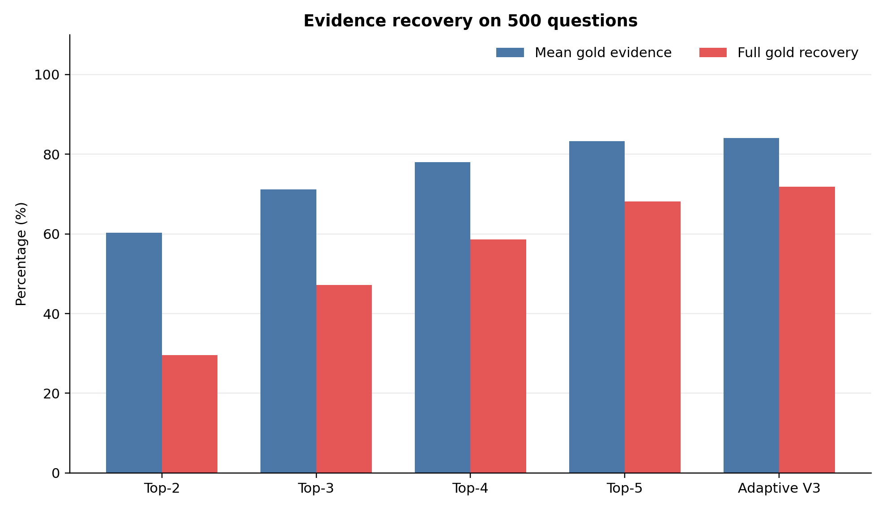
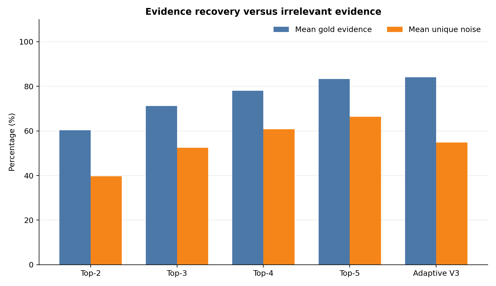
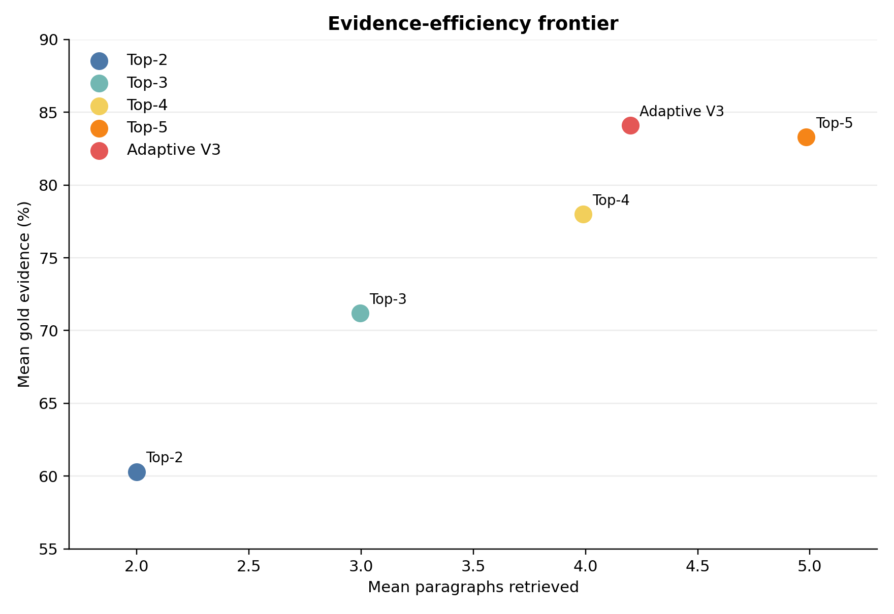
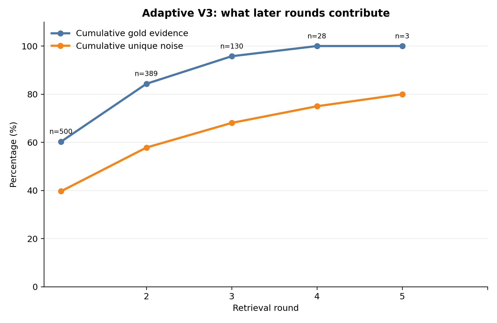
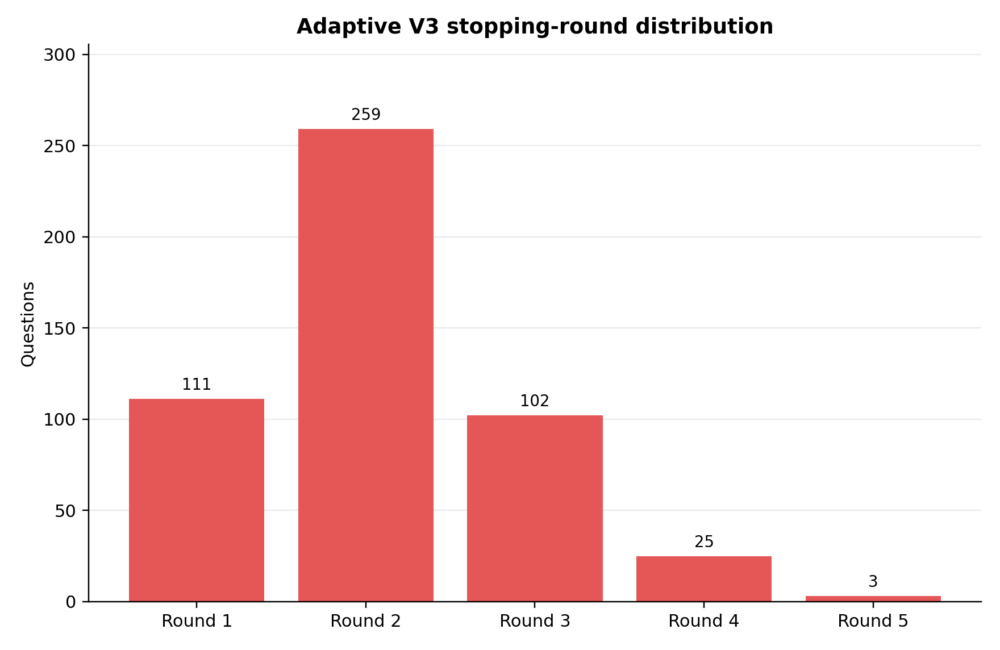
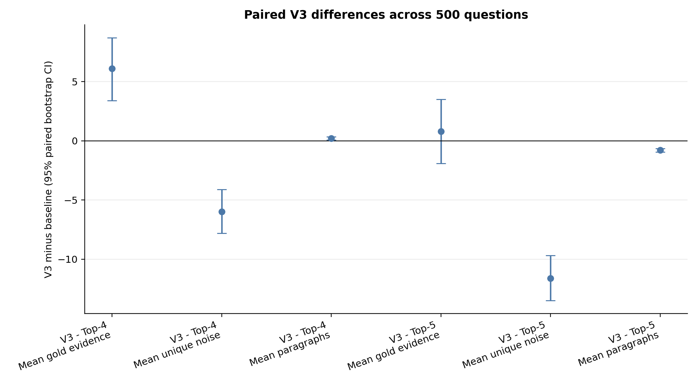

# Adaptive RAG: end-to-end experiment report

## Executive summary

This study evaluates whether an adaptive retrieval controller can recover the
evidence needed for multi-hop HotpotQA questions while reducing irrelevant
context and retrieval cost. The main 500-question evaluation compares fixed
Top-2, Top-3, Top-4, and Top-5 retrieval with Adaptive V3.

Adaptive V3 is the strongest evidence-efficiency result in the study. It
recovers **84.1% mean gold evidence** and achieves **71.8% full-gold
recovery**, compared with **83.3%** and **68.2%** for fixed Top-5. V3 also
retrieves fewer paragraphs on average (**4.20 versus 4.98**) and has lower
mean unique noise (**54.78% versus 66.39%**). Against the near-budget-matched
Top-4 baseline, V3 recovers substantially more gold evidence while using only
0.21 additional paragraphs on average.

The main limitation is controller behavior. Although V3 improves aggregate
retrieval quality, **351 of 500 runs (70.2%)** end through repeated-query
detection rather than an explicit sufficient decision. V3 also has a higher
zero-gold rate than Top-5 (**3.6% versus 1.6%**). The results therefore
support adaptive retrieval as an efficient retrieval strategy, while pointing
to query regeneration and failure analysis as the highest-value next steps.

## 1. Research question and experiment scope

The study asks:

> Can bounded adaptive retrieval recover more required evidence than fixed
> retrieval while adding less irrelevant context and using fewer retrieval
> resources?

The retrieval unit is a paragraph from the HotpotQA candidate context. A
paragraph is considered gold when it contains at least one annotated
supporting sentence. The evaluation is performed after retrieval has stopped;
gold labels are not provided to the retrieval controller.

The 500-question runs use:

- The same frozen question sample and candidate paragraph pool.
- MiniLM sentence embeddings and cosine similarity.
- Question-scoped retrieval.
- Qwen3-4B MLX 4-bit for adaptive controller decisions.
- A maximum of five adaptive retrieval rounds.

This report focuses on retrieval evidence recovery, noise, and cost. It is not
an end-to-end answer-accuracy or abstention evaluation.

## 2. System architecture

All systems share the same data preparation and retrieval foundation:

```text
HotpotQA question and candidate paragraphs
        |
        v
MiniLM paragraph embeddings + cosine ranking
        |
        +--> Fixed baseline: return Top-k once
        |
        +--> Adaptive system: return Top-2
                         |
                         v
              Qwen sufficiency controller
                   |              |
             sufficient       targeted query
                   |              |
                   v              v
                 stop       retrieve another Top-2
                                  |
                                  v
                     accumulate unique evidence
                     and repeat up to five rounds
```

### Fixed Top-k baseline

The original question is used as the retrieval query. The retriever returns
the highest-ranked `k` paragraphs once, with no model controller and no
follow-up retrieval. Top-2 through Top-5 establish the fixed retrieval-depth
trade-off.

### Adaptive V1

V1 starts with Top-2 retrieval. A Qwen3-4B controller receives the question
and accumulated evidence, then returns a structured decision:

- `sufficient`, or
- `need_more_evidence` with a missing fact and follow-up query.

V1 can issue additional Top-2 retrieval rounds, but duplicate paragraphs may
be returned. It uses a relatively simple sufficiency judgment and is
vulnerable to premature stopping and repeated retrieval.

### Adaptive V2.1

V2.1 retains the adaptive Top-2 loop but makes the controller’s reasoning
contract more explicit. The model must:

- Decompose the question into required information.
- Record established facts and supporting evidence IDs.
- List unresolved information items.
- Produce a targeted query for the missing relation.
- Use retrieval history when reformulating a query.

V2.1 adds loop-guard and query-regeneration behavior. Its structured output
improves evidence-chain checking, but the more complex output format led to
**37 controller errors in the 100-question development run**.

### Adaptive V3

V3 simplifies the controller output to one field:

```json
{"search_query": null}
```

or:

```json
{"search_query": "targeted follow-up query"}
```

Python, rather than the model, owns the retrieval state. It:

1. Starts with the original question and Top-2 retrieval.
2. Skips paragraphs already returned in previous rounds.
3. Returns the next two unseen paragraphs.
4. Supplies all accumulated unique evidence to the controller.
5. Stops on sufficiency, repeated-query detection, or the five-round limit.

This design removes duplicate returned paragraphs and avoids exposing gold
labels to the controller. It also bounds retrieval and model cost.

V1 and V2.1 are development versions evaluated in the canonical 100-question
comparison. The main 500-question benchmark contains the fixed Top-k baselines
and Adaptive V3.

## 3. Metrics and interpretation

For each question, let `G` be the set of frozen gold paragraph IDs, `U` the
set of unique retrieved paragraph IDs, and `R` the complete raw retrieval
history.

| Metric | Definition | Preferred direction |
|---|---|---|
| Mean gold evidence | `100 × |G ∩ U| / |G|`, averaged over questions | Higher |
| Full-gold recovery | Percentage of questions where `G ⊆ U` | Higher |
| Zero-gold recovery | Percentage of questions where `G ∩ U = ∅` | Lower |
| Mean unique noise | `100 × |U − G| / |U|`, averaged over questions | Lower |
| Mean paragraphs | Average `|R|`, including returned instances | Lower if recovery is maintained |
| Mean rounds | Average number of retrieval calls | Lower if recovery is maintained |
| Reasoning calls | Controller, repair, and query-regeneration calls | Lower if recovery is maintained |

Recovery and noise must be interpreted together. A system can increase
recovery simply by retrieving more paragraphs, but this may also increase
irrelevant context. The preferred system is therefore not necessarily the one
with the highest recovery alone; it should occupy a better recovery–cost–noise
trade-off.

## 4. Main 500-question results

| System | Mean gold evidence | Full recovery | Zero recovery | Mean noise | Mean paragraphs | Mean rounds |
|---|---:|---:|---:|---:|---:|---:|
| Top-2 | 60.3% | 29.6% | 9.0% | 39.70% | 2.00 | 1.00 |
| Top-3 | 71.2% | 47.2% | 4.8% | 52.40% | 3.00 | 1.00 |
| Top-4 | 78.0% | 58.6% | 2.6% | 60.77% | 3.99 | 1.00 |
| Top-5 | 83.3% | 68.2% | 1.6% | 66.39% | 4.98 | 1.00 |
| **Adaptive V3** | **84.1%** | **71.8%** | 3.6% | **54.78%** | **4.20** | **2.10** |

The fixed baselines show a predictable pattern: increasing `k` improves
evidence recovery, but noise increases at every step. V3 breaks this simple
fixed-depth pattern by achieving slightly higher recovery than Top-5 with
0.78 fewer paragraphs and 11.61 percentage points less noise.

Compared with Top-4, V3 uses only 0.21 additional paragraphs on average but
improves:

- Mean gold evidence by **6.1 percentage points**.
- Full recovery by **13.2 percentage points**.
- Mean noise by **5.99 percentage points**.

## 5. Figure-by-figure analysis

### Figure 1: evidence recovery



This figure compares mean gold evidence and full-gold recovery. Higher values
are better for both bars.

**Interpretation:** Fixed retrieval improves as more paragraphs are returned,
but the gains begin to flatten at Top-5. V3 is slightly above Top-5 on both
mean recovery and full recovery.

**Insight:** Adaptivity can reach the recovery level of a deeper fixed
retrieval policy without always paying for the full fixed-depth context.

### Figure 2: recovery versus irrelevant evidence



This figure places gold recovery and unique noise side by side. Noise is the
percentage of unique retrieved paragraphs that are not annotated gold
paragraphs.

**Interpretation:** Fixed Top-k retrieval creates a clear recovery–noise
trade-off. Top-5 recovers more evidence than Top-4, but its noise rises to
66.39%. V3 obtains higher recovery than Top-5 while reducing noise to 54.78%.

**Insight:** Recovery alone would hide the main benefit of V3. Its advantage
is evidence efficiency: more useful evidence with less irrelevant context.

### Figure 3: evidence-efficiency frontier



The x-axis is mean paragraphs retrieved and the y-axis is mean gold evidence.
A desirable system is higher and further left.

**Interpretation:** The fixed baselines form an upward curve: more paragraphs
produce more recovery. V3 lies above the fixed curve. It is slightly left of
Top-5 and above it on recovery.

**Insight:** This is the clearest visual summary of the central claim. V3
does not merely retrieve less; it selects additional retrieval budget
conditionally.

### Figure 4: adaptive progress by round



This figure shows cumulative gold recovery and cumulative unique noise for
questions reaching each V3 round. The `n=` annotations show the number of
questions still active at that round.

| Round | Questions reaching round | Gold recovery | Noise |
|---:|---:|---:|---:|
| 1 | 500 | 60.3% | 39.70% |
| 2 | 389 | 84.3% | 57.84% |
| 3 | 130 | 95.77% | 68.08% |
| 4 | 28 | 100.0% | 75.0% |
| 5 | 3 | 100.0% | 80.0% |

**Interpretation:** The largest gain occurs between rounds 1 and 2. Later
rounds handle a much smaller set of difficult questions and add more noise
as they search for increasingly hard-to-recover evidence.

**Insight:** Adaptive retrieval is most valuable when it selectively spends a
second retrieval round. Unbounded continuation would be inefficient because
the marginal recovery gain becomes smaller while noise increases.

The round points are conditional populations: later-round values describe
questions that reached those rounds, not the same 500-question population
with a fixed budget.

### Figure 5: stopping-round distribution



Most runs stop early:

- Round 1: 111 questions.
- Round 2: 259 questions.
- Round 3: 102 questions.
- Round 4: 25 questions.
- Round 5: 3 questions.

Together, **370 of 500 questions (74.0%)** stop by round 2.

**Interpretation:** V3 usually needs only one follow-up retrieval, which
explains its average of 2.10 retrieval rounds and 4.20 paragraphs.

**Insight:** The system is operationally bounded, but its stopping mechanism
is not yet ideal. The PDF reports 351 repeated-query stops (70.2%), while
only 146 runs (29.2%) end with an explicit `sufficient` decision. Repeated
query detection is therefore an important failure-analysis result.

## 6. Controller and cost findings

Adaptive V3 averages:

- **2.10 retrieval rounds**.
- **2.88 total reasoning-model calls**.
- **0.78 query-regeneration calls**.
- **0 repair calls**.
- **0 experiment errors**.

The absence of experiment errors and duplicate returned paragraphs is an
important improvement over V2.1’s 100-question development behavior. However,
the high rate of repeated-query termination shows that eliminating technical
errors did not fully solve controller quality.

The controller also has a small zero-gold tail. V3 has a zero-gold rate of
3.6%, compared with 1.6% for Top-5. Thus, V3 improves average and full
recovery but is not uniformly better on every question. This is consistent
with a more polarized outcome distribution: many questions benefit from
adaptivity, while a smaller set still fails to retrieve any annotated gold
evidence.

## 7. Evolution from V1 to V3

| Version | Main design | Observed issue | Design response |
|---|---|---|---|
| V1 | Basic sufficiency controller with adaptive Top-2 retrieval | Premature stopping and duplicate retrieval | Add explicit evidence-chain checks |
| V2.1 | Requirements, established facts, citations, and retrieval history | Structured-output complexity and controller errors | Simplify controller output and enforce unseen retrieval |
| V3 | Single search-query output, Top-2 unseen retrieval, cumulative unique context | Repeated-query termination and zero-gold tail remain | Future work should improve query regeneration and failure handling |

This progression should be interpreted as an architectural development story,
not as an isolated causal ablation. V2.1 and V3 changed multiple components,
including the prompt contract and duplicate-retrieval policy.

## 8. Additional analyses

The following analyses use paired question IDs from the same 500-question
sample. They are generated by
the advanced analysis section of [`analyze_outputs.ipynb`](analyze_outputs.ipynb).
The detailed tables are available in [`paired_bootstrap_ci.csv`](paired_bootstrap_ci.csv)
and [`stopping_quality.csv`](stopping_quality.csv).

### 8.1 Paired bootstrap confidence intervals



Each interval is based on 10,000 paired bootstrap resamples. The difference is
calculated as V3 minus the corresponding fixed baseline.

| Comparison | Metric | Mean difference | 95% CI |
|---|---|---:|---:|
| V3 - Top-4 | Mean gold evidence | +6.10 pp | [+3.40, +8.70] |
| V3 - Top-4 | Mean unique noise | -5.99 pp | [-7.82, -4.11] |
| V3 - Top-4 | Mean paragraphs | +0.21 | [+0.06, +0.35] |
| V3 - Top-5 | Mean gold evidence | +0.80 pp | [-1.90, +3.50] |
| V3 - Top-5 | Mean unique noise | -11.61 pp | [-13.48, -9.68] |
| V3 - Top-5 | Mean paragraphs | -0.78 | [-0.93, -0.64] |

**Interpretation:** V3's improvements over Top-4 are clearly positive for
gold recovery and clearly negative for noise, because their intervals exclude
zero. The small +0.8 percentage-point recovery difference over Top-5 has an
interval crossing zero, so the data supports comparable recovery rather than
an unqualified claim that V3 is more accurate. V3's reductions in noise and
paragraphs versus Top-5 are much more decisive.

### 8.2 Controller stopping quality


The stopping reason can be compared with final annotated gold completeness:

| Stop reason | Questions | Gold complete | Gold-complete rate |
|---|---:|---:|---:|
| `sufficient` | 146 | 87 | 59.6% |
| `repeated_query` | 351 | 269 | 76.6% |
| `max_rounds_reached` | 3 | 3 | 100.0% |

**Interpretation:** Repeated-query termination is not equivalent to retrieval
failure. Most repeated-query cases still contain all annotated gold evidence
at the time they stop, although the controller did not explicitly return
`search_query: null`. Conversely, explicit sufficiency is not always aligned
with complete annotated gold recovery: 59.6% of explicit sufficient stops are
gold-complete under this diagnostic.

This distinction is important. The repeated-query guard is a useful safety
mechanism that prevents unbounded looping, but its high activation rate shows
that the controller often fails to find a new search direction. The stopping
reason should therefore be reported separately from the evidence-quality
metrics.

## 8. Limitations

1. **Annotated gold is a diagnostic target.** A question may have a
   semantically valid evidence path that differs from the annotated support
   paragraphs. Gold-based false sufficiency therefore does not prove that the
   controller’s evidence was semantically inadequate.
2. **V1 and V2.1 are not 500-question comparisons.** They are 100-question
   development versions and should be presented separately from the main
   500-question benchmark.
3. **V3 combines two changes.** The compact controller and unseen-retrieval
   policy were introduced together, so their individual causal effects are
   not isolated.
4. **Bootstrap intervals quantify sampling uncertainty, not all experimental
   uncertainty.** The paired intervals use the fixed 500-question sample and
   do not establish causal separation of V3's compact controller from its
   unseen-retrieval policy.
5. **No answer-quality conclusion follows automatically.** Better paragraph
   recovery and lower noise do not by themselves prove higher final-answer
   accuracy.

## 9. Recommended next analysis

The current experiment is broad enough for the assignment. The most valuable
next analyses are:

1. Report the paired bootstrap intervals and per-question categories alongside
   the aggregate means.
2. Manually classify 20–30 V3 failures into initial retrieval failure, poor
   bridge query, retriever-ranking failure, premature stopping, repeated-query
   termination, and over-retrieval.
3. Quantify per-question gains from Round 1 to later rounds.
4. Treat repeated-query termination as a limitation rather than tuning the
   system against the evaluation results.

## 10. Conclusion

Fixed Top-k retrieval exhibits a clear evidence–noise trade-off: retrieving
more paragraphs improves gold evidence recovery but progressively increases
irrelevant context. Adaptive V3 shifts this trade-off by beginning with a
small evidence set and spending additional retrieval budget only when the
controller requests it.

Across 500 questions, V3 achieves **84.1% mean gold evidence recovery** and
**71.8% full recovery** using **4.20 paragraphs on average**, compared with
**83.3%**, **68.2%**, and **4.98 paragraphs** for Top-5. It also lowers mean
unique noise from **66.39% to 54.78%**. The strongest gains occur in the
second retrieval round, supporting the value of bounded adaptive evidence
acquisition.

V3 is therefore the preferred final architecture for this study, but not a
perfect controller. Its repeated-query termination rate and zero-gold tail
should be reported openly. The evidence supports the conclusion that
adaptive retrieval is more efficient than fixed retrieval at comparable
recovery, while further work should focus on uncertainty estimation and
systematic failure analysis rather than another major architecture revision.
