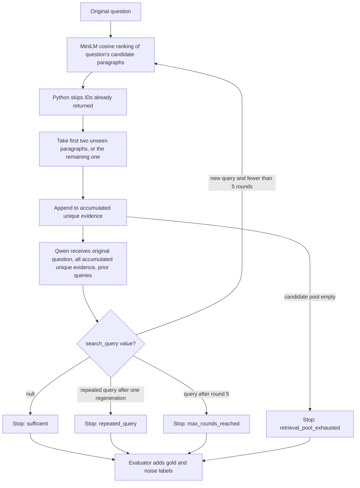

# Experiment architecture, history, and canonical results

This guide describes the seven canonical 100-question paragraph-retrieval runs. [The run registry](canonical_runs.json) is the authoritative map from experiment names to folders, result files, immutable result hashes, and the exact ordered question IDs. [Setup and run](SETUP_AND_RUN.md) has commands. The separate answer/abstention study is not part of these comparisons.

## What the project measures

For each HotpotQA question, the prepared data retains its candidate context paragraphs and the paragraph IDs containing annotated supporting sentences. The question is the retrieval query. MiniLM embeddings and cosine similarity rank only that question's candidate paragraphs. A retriever may return some relevant paragraphs, irrelevant paragraphs, or both. The evaluator compares returned IDs with the frozen annotated gold IDs **after** retrieval and controller decisions finish.

All seven runs use the same ordered 100 questions from the seed-88, 1,000-question development pool; the ordered ID-list SHA-256 is `eef5d006a21f842f39973e81fdaf2b73282439c7fd10395fb4b7af7b94042fcf`. They share the HotpotQA revision, candidate corpus, paragraph construction, MiniLM revision, cached vectors, cosine ranking, and paragraph IDs. Fixed Top-2/3/4/5 differ only in `k`. The adaptive systems share Top-2 and a five-round cap but use different controllers. V3 also changes the retrieval policy, so V2.1 versus V3 is a **two-component architecture comparison**, not an isolated prompt ablation.

## How the systems evolved

| System | Main change | Problem addressed | Main limitation | Why the next version was introduced |
|---|---|---|---|---|
| Fixed Top-k | One original-question query returns the highest-ranked k paragraphs; no model call | Establishes retrieval-depth references | More k tends to expose more irrelevant evidence | Test whether adaptive stopping can save context |
| Adaptive V1 | Qwen3-4B assesses sufficiency after Top-2 and proposes follow-up queries | Introduces adaptive retrieval | 58/115 gold-incomplete decisions stopped sufficient; later rounds repeated paragraphs | Require explicit evidence-chain checks |
| Adaptive V2.1 | Structured requirements, established facts and citations, missing items, retrieval history | Reduced gold-based false sufficiency to 29/81 | Duplicate retrieval, complex output, 37/100 controller errors | Simplify output and fill slots with unseen evidence |
| Adaptive V3 | Single `search_query` output and Top-2 unseen retrieval; all accumulated unique evidence remains in context | Eliminated returned duplicates and experiment-level errors in the 100-run | 71 repeated-query stops; 20 ended with incomplete annotated gold | Query regeneration needs a focused future revision before scaling |

These are observed outcomes, not proof that either individual V3 change caused a specific gain. V1 and V2.1 remain reproducible historical steps. The clean V2.1 run used prompt version `retrieval-controller-v2.1`; an earlier sample-contaminated V2 prompt pilot was removed from canonical outputs.

## V3 flow

Python owns the seen-ID set, queries, round number, candidate scope, filtering, stop reason, and call counts. The model outputs only `{"search_query": null}` or `{"search_query": "<targeted query>"}`. Its prompt asks it to internally verify every necessary relation against supplied text; it does not request chain of thought. Gold IDs, gold completeness, gold percentage, noise, and evaluator judgments never appear in the model prompt and never control retrieval, query generation, or stopping.

### Why cumulative unique evidence matters

Suppose Round 1 returns `[3, 4]`. Python sets `seen_ids = {3, 4}`, and the model sees paragraphs `[3, 4]`. A Round-2 query ranks `[3, 5, 7, …]`. Python skips seen ID `3`, takes `5` and `7`, and returns `[5, 7]`. It then supplies **all** accumulated unique paragraphs `[3, 4, 5, 7]` to the model. The context is neither just `[5, 7]` nor `[3, 4, 3, 5]`. A skipped ranking hit does not consume a returned-paragraph slot or count as a raw retrieval, but earlier evidence remains available for multi-hop reasoning.

If the model still requests evidence after Round 5, its proposed query is saved and the run stops without Round 6. If only one unseen candidate remains, V3 returns one; if none remains, it stops cleanly. A repeated query gets one bounded regeneration attempt, then a clean `repeated_query` stop if the model repeats it. Malformed output receives at most one format repair; a failed repair is an actual model-output error.

## Canonical output folders

All paths below are relative to the repository root. The folder name is a clear display name; each `run_metadata.json` retains the immutable historical run ID.

| Folder under `outputs/` | Strategy and purpose | Controller / duplicate policy | Max rounds |
|---|---|---|---:|
| `baseline_top2_single_shot_same100/` | Original question → fixed Top-2 once | No model; no follow-up | 1 |
| `baseline_top3_single_shot_same100/` | Original question → fixed Top-3 once | No model; no follow-up | 1 |
| `baseline_top4_single_shot_same100/` | Original question → fixed Top-4 once; closest fixed paragraph budget to V3 | No model; no follow-up | 1 |
| `baseline_top5_single_shot_same100/` | Original question → fixed Top-5 once; original reference | No model; no follow-up | 1 |
| `adaptive_v1_top2_basic_controller_same100/` | Top-2 each round with a basic sufficiency decision and follow-up query | V1; duplicate returns are possible | 5 |
| `adaptive_v2_top2_evidence_chain_controller_same100/` | Top-2 with structured evidence-chain verification and retrieval history | Clean V2.1; duplicate returns are possible | 5 |
| `adaptive_v3_top2_unseen_compact_controller_same100/` | Top-2 **unseen** each round; cumulative unique context | V3 single-field controller; seen IDs are skipped before return | 5 |

The earlier 500-question Qwen3-1.7B answer/abstention study is preserved separately as `archive/historical_subset_500_seed88_rag_abstention.zip`. Its 459 recorded answers and 41 unrecorded assessment failures make it unsuitable as a same-100 fixed retrieval baseline.

### Files within the folders

| File | Meaning | Provenance level |
|---|---|---|
| `results.jsonl` | One record per question, including returned paragraphs, scores, rounds, status and evaluator fields | Raw saved experiment observations; do not rewrite |
| `run_metadata.json` | Resolved config, historical run ID, model/index/input hashes, prompt hashes, selected IDs, status and counts; now also canonical display path | Run provenance |
| `summary.json`, `summary.csv` | Aggregate metrics computed from that run's records | Derived; may be regenerated without changing results |
| `errors.jsonl`, `events.jsonl` | Explicit errors and runtime/model events; files may be empty for successful fixed baselines | Run logs |
| V1 `original_paired_metadata.json` | Byte-preserved original Top-5/V1 paired manifest with the exact ordered IDs; its SHA-256 is referenced by later runs | Historical sample provenance |
| V1 `paired_baseline_top5_v1*` | Original paired Top-5/V1 differences and summary | Derived historical comparison |
| V2.1 `three_way_comparison.json/.csv`, `paired_adaptive_v1_v2.jsonl` | Top-5/V1/V2.1 comparison and paired retrieval changes | Derived comparison |
| V3 `four_way_comparison.json/.csv`, `paired_v2_v3.jsonl` | Top-5/V1/V2.1/V3 comparison and paired changes | Derived comparison |
| V3 `canonical_comparison.json/.csv` | Regenerated seven-run comparison validated against the registry | Derived final-project comparison |

The V1 paired metadata contains original historical paths from the time of that run. It remains byte-preserved because its hash anchors the later sample manifests; [the registry](canonical_runs.json) maps those historical experiments to their current folders.

### Reading a V3 question record

`question_id` and `question` identify the original question. `rounds` contains each `retrieval.query`, returned `retrieval.evidence` IDs/titles/text/scores/original rank, `ranked_candidate_ids_considered`, `ranked_seen_ids_skipped`, `new_unique_ids`, `cumulative_unique_paragraph_ids`, `raw_model_responses`, parsed `next_query`, repair/regeneration flags and per-round `stop_reason`. At the question level, `stop_reason` and `final_model_status` explain termination; `raw_paragraphs_retrieved`, `unique_paragraphs_retrieved`, `gold_evidence_percentage`, `noise_percentage` and `gold_retrieved_ids` summarize retrieval and evaluator labels. `controller_model_calls`, `repair_model_calls`, `query_regeneration_model_calls` and `total_reasoning_model_calls` separate model cost from paragraph cost. Gold fields are saved **after** the controller has acted. Reliable token-usage counts are unavailable from the current MLX text-generation interface and are not estimated.

## Metric guide

For a question, let `G` be its frozen annotated gold paragraph IDs, `U` its distinct returned paragraph IDs, and `R` the list of all **returned instances**. The means below average the per-question percentages over all 100 attempts, including records whose controller later errored, because retrieval is still observable.

| Metric | Definition | Preferred direction | Systems |
|---|---|---|---|
| Gold evidence % | `100 × |G ∩ U| / |G|`, then mean or median across questions | Higher | All seven |
| Full gold recovery | Percentage of questions with gold evidence = 100%; 71/100 means 71% | Higher | All seven |
| Zero gold recovery | Percentage of questions with gold evidence = 0% | Lower | All seven |
| Unique noise % | `100 × |U − G| / |U|` for each question, then mean; zero when `U` is empty | Usually lower | All seven |
| Raw paragraphs | `|R|`: all paragraph instances actually returned; skipped V3 ranking hits are excluded | Lower if recovery holds | All seven |
| Unique paragraphs | `|U|`: distinct returned evidence IDs; repeated V1/V2 returns count once here | Lower if recovery holds | All seven |
| Retrieval rounds | Number of retrieval calls made for a question | Lower if recovery holds | All seven; fixed runs always 1 |
| Controller calls | Normal post-retrieval reasoning-model invocations | Lower if recovery holds | V3 recorded; fixed runs 0; historical V1/V2 N/A |
| Regeneration calls | Extra reasoning calls after a repeated query | Lower if recovery holds | V3 recorded; fixed runs 0; historical V1/V2 N/A |
| Total reasoning calls | Controller + format repair + query regeneration | Lower if recovery holds | V3 recorded; fixed runs 0; historical V1/V2 N/A |
| Experiment errors | Records ending with an actual controller/model error | Lower | All seven |

The annotated HotpotQA gold path is not guaranteed to be the only semantically sufficient path. “Gold-based false sufficiency” therefore means the controller stopped while annotated gold was incomplete; it is a diagnostic, not proof of an unsupported final answer. No arbitrary weighted score combines recovery, noise and cost.

## Main comparison: fixed depth versus V3

| Metric | Top-2 | Top-3 | Top-4 | Top-5 | Adaptive V3 |
|---|---:|---:|---:|---:|---:|
| Mean gold evidence | 57.5% | 71.0% | 78.0% | 84.5% | 82.0% |
| Median gold evidence | 50% | 50% | 100% | 100% | 100% |
| Full gold recovery | 27% | 47% | 59% | 70% | 71% |
| Zero gold recovery | 12% | 5% | 3% | 1% | 7% |
| Mean unique noise | 42.5% | 52.3% | 60.5% | 65.6% | 54.8% |
| Mean raw / unique paragraphs | 2.00 / 2.00 | 2.99 / 2.99 | 3.98 / 3.98 | 4.97 / 4.97 | 4.16 / 4.16 |
| Mean retrieval rounds | 1 | 1 | 1 | 1 | 2.08 |
| Mean reasoning-model calls | 0 | 0 | 0 | 0 | 2.86 |
| Experiment errors | 0 | 0 | 0 | 0 | 0 |

Top-4 is the closest fixed paragraph budget: V3 returns 0.18 more paragraphs on average and has 4.0 percentage points more mean gold evidence, 12 points more full recovery, and 5.7 points less mean unique noise. V3 also has 4 points **more** zero-gold questions and incurs reasoning-model cost. Top-5 has 2.5 points more mean gold evidence than V3 but returns 0.81 more paragraphs and has 10.8 points more mean unique noise. These trade-offs should be reported together.

V3 stopped `sufficient` 28 times, `repeated_query` 71 times, and `max_rounds_reached` once. Of the repeated-query stops, 20 still lacked complete annotated gold evidence. Its mean call counts were 2.08 normal controller, 0 repair, 0.78 regeneration, and 2.86 total. The repeated-query behavior is the main reason to review V3 before a 1,000-question run.

## Historical development comparison

| Metric | Top-5 | Adaptive V1 | Adaptive V2.1 | Adaptive V3 |
|---|---:|---:|---:|---:|
| Mean gold evidence | 84.5% | 60.5% | 71.0% | 82.0% |
| Full gold recovery | 70% | 32% | 50% | 71% |
| Mean unique noise | 65.6% | 42.0% | 40.25% | 54.8% |
| Mean raw paragraphs | 4.97 | 2.94 | 3.40 | 4.16 |
| Experiment errors | 0 | 0 | 37 | 0 |

V2.1 improved stopping relative to V1 but had complex-output and repeated-query errors. V3 removed experiment-level errors and duplicate returns, gaining recovery while adding unique paragraphs and noise. The V3 change combined a compact controller and an unseen retrieval policy, so this table does not isolate their individual causal effects.

## Cleanup record

The following noncanonical output folders were removed after verifying the four canonical source runs and saving their hashes in an audit inventory:

| Removed folder under `outputs/` | Reason |
|---|---|
| `phase3-n100-seed88-top5-adaptive2x5/` | Duplicate per-question Top-5 and V1 results; canonical copies had the same result hashes |
| `phase3-n100-seed88-top5-adaptive2x5-v3/` | Known sample-contaminated V2 prompt pilot, superseded by clean V2.1 |
| `phase3-v2-1-sanity-n3-seed88/` | Interrupted three-question sanity run |
| `phase3-v2-1-sanity-n3-seed88-retry/` | Three-question V2.1 sanity run |
| `phase3-v2-sanity-n3-seed88/` | Failed three-question sanity run |
| `phase3-v2-sanity-n3-seed88-final/` | Three-question sanity run |
| `phase3-v2-sanity-n3-seed88-retry/` | Three-question sanity run |
| `phase3-v2-sanity-n3-seed88-v2/` | Three-question sanity run |
| `phase3-v3-sanity-n4-seed88/` | Failed four-question run with no results |
| `phase3-v3-sanity-n4-seed88-metal/` | Four-question V3 sanity run superseded by the canonical 100-question run |

The original pair's result values, clean V2.1 and V3 `results.jsonl` files, and all fixed baseline results were preserved. The obsolete contaminated-pilot config and its two prompts were removed; the V1, clean V2.1 and V3 prompts/configs, historical answer/abstention code, tests and caches remain. The separate 500-question ZIP was moved to `archive/` without changing its contents.
