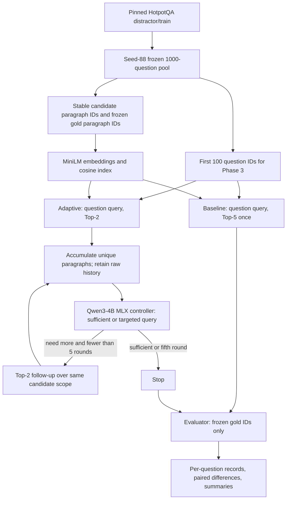

# Paragraph retrieval architecture and metrics

The main SC4001 study asks whether adaptive multi-round retrieval recovers a higher proportion of required HotpotQA evidence while introducing less irrelevant unique evidence than one fixed Top-k retrieval. The unit is a question and its supplied HotpotQA candidate context paragraphs. No answer generation or abstention accuracy is part of the main comparison. Historical answer/abstention code remains isolated in `scripts/run_experiment.py` for reproducibility.

## Data and flow



HotpotQA marks support at sentence level. `data/hotpotqa.py` maps each annotated support sentence to the containing context paragraph and persists that paragraph's stable `evidence_id` as `gold_paragraph_ids` (also retained under the historical `gold_support_ids` name). The original title/sentence-index annotations remain in `QuestionRecord.metadata.supporting_facts` for audit. The prepared question keeps candidate IDs, source split/revision, gold answer, and support labels for evaluation. All 1,000 selected questions have unique IDs, at least one gold paragraph, and question-scoped candidate context. Source indices/order, revision/fingerprint, seed, preprocessing version and artifact hashes are in the selection manifest.

The retriever uses the same cached MiniLM vectors, cosine ranking, paragraph text representation, and question candidate scope for baseline and adaptive. It never receives gold labels. The model receives only question ID/text and unique accumulated evidence IDs/titles/text through `ModelEvidence`; no answer or gold labels enter its prompt. Gold completeness is annotated only after the controller has stopped, including on each saved round for secondary analysis. The evaluator never stops retrieval.

## Policies and stopping

Baseline: retrieve up to five paragraphs for the original question, exactly one retrieval call, no Qwen invocation. Adaptive: initial Top-2 for the original question; after each round, assess unique accumulated paragraphs. A `sufficient` decision stops immediately. A `need_more_evidence` decision supplies missing information and a targeted query. Follow-up Top-2 searches the same question-scoped candidate corpus and may return a paragraph seen earlier. Retrieval stops after at most five rounds (at most ten raw returned instances). The final model status remains `need_more_evidence` when the cap is reached. A malformed response gets one structured repair attempt; if still invalid, the question retains its partial retrieval record with `final_model_status: ERROR` and an explicit error sidecar. Such records are excluded from quality means and counted separately.

The current model config is pinned Qwen3-4B MLX 4-bit with greedy, non-thinking inference. The model ID/revision are settings and CLI parameters. `SLMSufficiencyAssessor`, strict JSON parsing, query generation, MLX model caching, `DenseRetriever`, JSONL persistence, and provenance hashing are shared with the existing repository. `scripts/run_retrieval_study.py` is one entry point with baseline, adaptive, and combined modes; combined mode calls the same per-system implementation used by independent runs.

## Raw retrieval and unique evidence

Every round saves its query, ordered retrieved paragraphs (IDs, titles, text, scores), new unique IDs, duplicate IDs, model decision, missing information, next query, raw model responses, and evaluation-only gold completeness. The controller receives one copy of each distinct paragraph. The raw retrieval history retains duplicate appearances and their retrieval cost.

Example required for interpreting the metrics:

- Gold paragraphs: {2,3}
- Round 1: {1,3}; Round 2: {3,4}; Round 3: {2,4}
- Raw retrieved instances: [1,3,3,4,2,4] = **6**
- Unique paragraphs: {1,2,3,4} = **4**
- Gold recovered: {2,3} = **2/2 = 100%**
- Noise: {1,4} = **2/4 = 50%** of unique paragraphs
- Retrieval rounds/calls: **3**

Duplicates count toward raw retrieval cost once per returned instance. They count once in the unique evidence set and never inflate the unique-noise denominator. `raw_paragraphs_retrieved`, `unique_paragraphs_retrieved`, `duplicate_retrieval_count`, and `retrieval_rounds` are distinct fields.

## Primary metrics

For each question, let G be the frozen set of gold paragraph IDs, U the unique retrieved set, and R the concatenation of all raw round results.

| Metric | Formula | Aggregate |
|---|---|---|
| Percentage of Gold Evidence Obtained | 100 × \|G ∩ U\| / \|G\| | Mean, median, population standard deviation; full and zero recovery rates |
| Noise to Total Unique Paragraph Percentage | 100 × \|U − G\| / \|U\|; zero when U is empty | Mean, median, population standard deviation |
| Average Number of Paragraphs Retrieved | \|R\|, including duplicates | Mean, median, population standard deviation, min/max |

Average Retrieval Rounds is a separate secondary cost statistic; a six-instance retrieval across three rounds is three calls, not six calls. Means exclude controller-error records and always show the valid/error denominators. Secondary metrics include average unique paragraphs, duplicate count and percentage, stopping-round distribution (rounds 1–5), ending model status, evidence/noise by stopping round, and model-stop errors relative to gold completeness. `paired.jsonl` stores adaptive-minus-baseline per-question gold percentage, noise percentage, and raw instance count for valid pairs. No scalar weighted score combines the trade-off.

Model sufficiency is Qwen's prediction; ground-truth completeness means all frozen gold paragraph IDs were retrieved. A real paragraph can be relevant without being annotated, and a model may stop too early or continue unnecessarily. These diagnostics do not change the three primary metrics or control the run.

## Contracts, artifacts, and provenance

`QuestionRecord` holds candidate and frozen gold IDs; `EvidenceChunk` holds stable paragraph ID/title/text; existing `RetrievalRequest`/`RetrievalResult` hold query, rank and score. `ModelEvidence` is a gold-free view for the assessor. `StudyRound` and `RetrievalStudyRecord` in `contracts/retrieval_study.py` validate the raw/unique/gold/noise counts and final status. The historical `ExperimentRecord` remains for old answer/abstention artifacts. The schema can be checked with `scripts/validate.py jsonl ... --schema retrieval-study-record`.

```text
outputs/<comparison-run-id>/
  metadata.json                 paired run references and hashes
  summary.json                  baseline/adaptive aggregate metrics
  comparison.csv                metric table
  paired.jsonl                  per-question paired differences
  baseline/
    run_metadata.json           resolved config, source/index hashes, timestamps, Git/packages
    results.jsonl               one row per attempted question
    errors.jsonl                explicit failures
    events.jsonl                model events (normally empty for baseline)
    summary.json, summary.csv
  adaptive/
    run_metadata.json, results.jsonl, errors.jsonl, events.jsonl
    summary.json, summary.csv
```

An independent mode writes the same per-system files directly under `outputs/<run-id>/`. Output creation refuses an existing run directory. Dataset cache reuse checks source revision, seed, size, preprocessing version and artifact hashes; index reuse checks ordered corpus/content hash, encoder ID/revision/dimension, dataset revision and similarity configuration. Model snapshots use exact ID/revision. Results are never reused merely because a similar run name exists.
