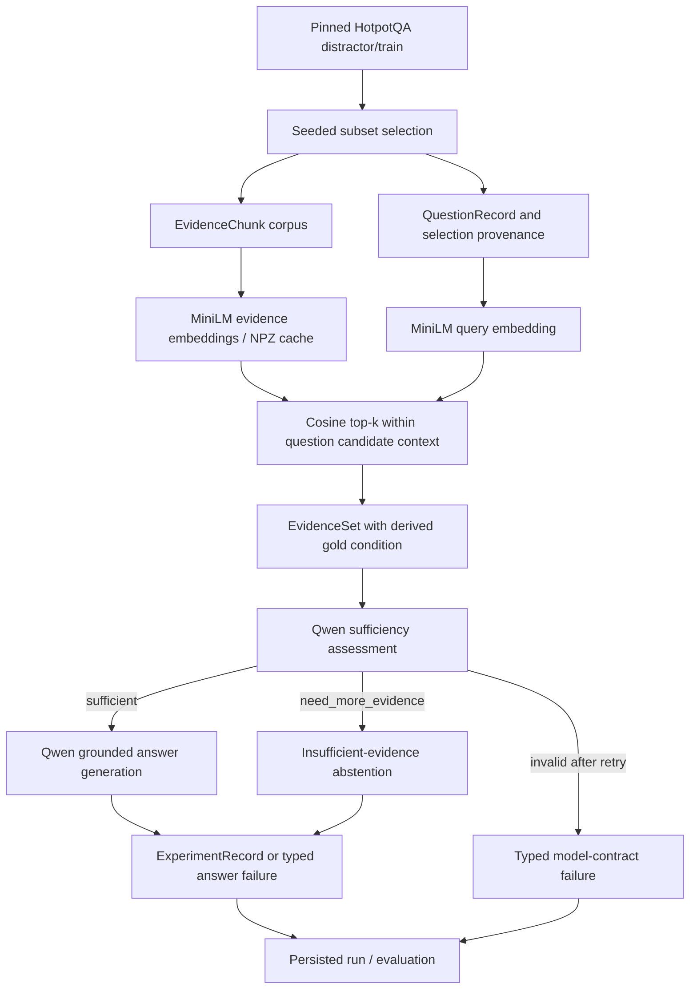

# System architecture

The implemented system is a **single initial retrieval plus RAG + Abstention baseline**. It connects a deterministic HotpotQA data pipeline to MiniLM retrieval and a shared Qwen MLX client. The former HTML architecture description was checked against source and consolidated here; adaptive search remains a future extension.

## End-to-end architecture



Gold answers and support IDs are used for labeling/evaluation, not shown to Qwen. Assessment prompts contain question ID/text and supplied evidence ID/title/text. The generated `search_query` is stored when evidence is insufficient but is **not executed**. The answer generator is invoked only after a valid `sufficient` decision. Empty evidence still goes through assessment; the baseline does not introduce a separate retrieval-failure policy.

MiniLM `all-MiniLM-L6-v2` produces 384-dimensional vectors on CPU. Retrieval uses cosine similarity and the configured initial depth of 3. The corpus contains selected questions' paragraphs, while each question is scoped to its supplied HotpotQA candidate IDs. This is a **distractor-context retrieval experiment**, not open-domain search over all Wikipedia. Increasing subset size increases question count and corpus preparation work but does not broaden each question's search scope.

Qwen3-1.7B uses the pinned MLX 4-bit conversion. One loaded model is shared by stateless assessor/answer adapters. Generation is greedy with temperature 0, no sampling and thinking disabled. Input limit 8,192, output limit 512; oversized prompts fail rather than being silently truncated. Legacy Qwen3 chat templates that ignore `enable_thinking=False` receive the canonical empty think suffix. No chain-of-thought is stored. Each structured task has at most one formatting repair attempt; this is not a second retrieval round.

## Repository map

```text
README.md                         short navigation
pyproject.toml                    dependencies, package, lint/test settings
.env.example                      optional authentication instructions
.gitignore                        generated data, caches, outputs, secrets
.github/pull_request_template.md   review checklist
configs/
  base.yaml                       single shared experiment configuration
documentation/
  SETUP_AND_RUN.md
  SYSTEM_ARCHITECTURE.md
  OUTPUTS_AND_ANALYSIS.md
scripts/
  __init__.py                     allows direct CLI testing
  check_environment.py
  prepare_hotpotqa.py
  prepare_models.py
  build_embedding_index.py
  run_experiment.py
  evaluate_results.py
  freeze_hotpotqa_splits.py
  validate.py
src/reliable_rag/
  config/                         validated YAML/env settings and derived paths
  contracts/                      enums, IDs, Pydantic records, Protocol interfaces
  data/                           normalization, preparation, sampling/splits, evidence conditions
  io/                             strict JSONL and hashed/atomic JSON artifacts
  retrieval/                      encoder, index persistence, scoped cosine ranking
  model/                          MLX client, parsing, assessor, generator, abstention
  evaluation/                     fixed metric definitions
  assets.py                       offline-first verified model resolution
  runtime.py                      component factories
  pipeline.py                     one-case baseline integration
  run_artifacts.py                run protection, streaming persistence, provenance
prompts/                          three versioned runtime .txt templates
schemas/                          eight generated JSON Schema files
tests/                           unit/integration tests and contract fixtures
data/                            generated source/prepared data; small split manifests
cache/                           generated dataset/model/vector caches
outputs/                         generated per-run results
```

`__init__.py` files expose package entry points. Generated directories need no committed placeholders. The historical 500-question run is preserved locally as an ignored scientific artifact. Obsolete two-question examples and the separate synthetic smoke artifacts were removed. Prompt `.txt` files are executable templates, not duplicate project documentation.

## Entry points

The normal flow has six commands: environment report, dataset preparation, model preparation, index preparation, experiment, evaluation. `freeze_hotpotqa_splits.py` is a separate optional research operation because sampling questions and assigning disjoint evaluation partitions are different actions. `validate.py` groups configuration validation, contract JSONL validation and schema generation. Full syntax and examples live in [setup and run](SETUP_AND_RUN.md).

Experiment execution derives paths from the same subset size, seed and shared YAML used by preparation. It can accept explicit questions/evidence/index for frozen split work, or aligned saved retrieval for repeatable inference comparisons. A `--limit` changes only the number of evaluated questions. It does not rebuild the corpus or create a new random subset. A unique run ID identifies each observation set.

## Source modules and responsibilities

| Module | Responsibility |
| --- | --- |
| `config/settings.py` | Strict Pydantic configuration, approved environment overrides, seed 88, derived dataset/index paths, retrieval-round upper bound. No hidden config merging. |
| `contracts/enums.py` | Stable serialized partition, condition, system variant, sufficiency, retrieval stage and abstention labels. Reserved future labels remain for compatibility. |
| `contracts/ids.py` | Deterministic evidence/experiment ID construction. |
| `contracts/records.py` | Canonical Pydantic records, uniqueness and cross-field invariants, evidence-state properties. |
| `contracts/interfaces.py` | Retriever, SufficiencyAssessor, AnswerGenerator and future AdaptiveController protocols. No controller algorithm. |
| `data/hotpotqa.py` | Reads raw JSON/JSONL and Hugging Face record shapes; joins sentences into paragraphs, maps supporting facts to paragraph evidence, creates stable document/evidence IDs, handles title collisions. |
| `data/preparation.py` | Prepares a split, de-duplicates identical global evidence and disambiguates same-ID/different-text paragraphs deterministically; writes canonical questions/evidence plus split manifest. |
| `data/splits.py` | Seeded shuffled-prefix subset selection; independently freezes disjoint development/validation/test assignments and ID-only manifests. Larger same-seed subsets contain smaller selections as a prefix. |
| `data/evidence_conditions.py` | Constructs controlled complete, partially incomplete, fully incomplete and distractor-heavy evidence for research/tests. The normal baseline derives actual condition from retrieved support coverage. |
| `io/jsonl.py` | Reads/writes canonical records with schema validation; malformed rows fail with path/line context. |
| `io/artifacts.py` | Streaming SHA-256 and atomic JSON metadata writes. |
| `assets.py` | Finds exact Hub revisions locally, validates tokenizer/weight shards and SentenceTransformer modules, fetches only when explicitly allowed. |
| `retrieval/embedder.py` | Lazy SentenceTransformer adapter; ordered evidence/text fingerprint; compressed NPZ save/load/compatibility; batched index preparation using a temporary disk-backed vector array. |
| `retrieval/retriever.py` | Validates corpus/query dimensions and candidate IDs, normalizes vectors for cosine similarity, ranks evidence, attaches scores and preserves requested retrieval stage/top-k. Supports exclusion IDs for a future caller. |
| `model/slm.py` | Injectible generation protocol and MLX-LM implementation; runtime/model checks, project seed, chat formatting, token limits and deterministic sampler. |
| `model/structured_output.py` | Prompt loading/rendering, JSON extraction and strict parsing, canonical required keys, formatting retry prompt construction. |
| `model/sufficiency.py` | Evidence-only Qwen assessment; verifies question ID, supplied support IDs and status-specific fields; repairs once then raises typed output error. |
| `model/answer.py` | Grounded answer generation; verifies used evidence IDs and answer/abstention consistency; repairs once then raises typed output error. |
| `model/errors.py` | ModelOutputError with task, question ID, attempts, abstention reason and validation message; excludes raw prompt/output. |
| `model/abstention.py` | Policy gate: insufficient decision abstains, sufficient decision invokes generation; preserves malformed assessment versus malformed answer distinctions. |
| `runtime.py` | Constructs reusable encoder/retriever and one shared MLX client with independent assessor/generator interfaces. Factories default to no downloading. |
| `pipeline.py` | Converts initial retrieval to labeled EvidenceSet; runs one responder case; creates ExperimentRecord only when a real sufficiency decision exists. |
| `run_artifacts.py` | Validates run IDs, refuses accidental overwrite/input collisions, records config/input/prompt hashes, versions/Git state, flushes result/error/event rows and updates progress. |
| `evaluation/metrics.py` | Existing numerator/denominator definitions for retrieval, sufficiency classification, coverage, abstention and unsupported answering. |

`tests/` contains schema/JSONL/config tests, deterministic preparation/sampling tests, index compatibility/scoped retrieval tests, MLX adapter tests with injected clients, strict model parsing/policy tests, integration and persistence/evaluation tests. `tests/fixtures/sufficiency_cases.json` is explicitly synthetic automated test input; ordinary user experiments use real HotpotQA through the normal scripts.

## Contracts and ID flow

| Contract | Important fields and relationship |
| --- | --- |
| `QuestionRecord` | `question_id`, question text, `gold_answer`, project `split`, `gold_support_ids`, `candidate_evidence_ids`, metadata. Links a source question to support annotations and its legal retrieval scope. |
| `EvidenceChunk` | `evidence_id`, `document_id`, title, text, optional score. A paragraph, not a single supporting sentence. Same corpus chunk is reused across questions when identical. |
| `EvidenceSet` | `question_id`, controlled `condition`, evidence list, `gold_support_ids`; derived `evidence_ids`, `gold_sufficient`, `missing_support_ids`. Gold sufficient means all annotated support paragraphs are present. |
| `RetrievalRequest` | `question_id`, query, initial/follow-up stage, top-k, excluded evidence IDs. Initial baseline queries equal question text. |
| `RetrievalResult` | Question/query/stage/top-k and ranked EvidenceChunk list; unique evidence IDs, no more than requested depth. |
| `SufficiencyDecision` | Question ID, `sufficient`/`need_more_evidence`, missing information, optional search query, `supporting_evidence_ids`. These are model predictions; the parser verifies cited IDs came from supplied evidence. |
| `AnswerResult` | Question ID, answer/null, abstained flag, abstention reason/null, `used_evidence_ids`. Answering and abstention states must be internally consistent. |
| `AdaptiveRoundRecord` | Round index, optional retrieval, sufficiency decision. Nested in ExperimentRecord; baseline has only round 0. |
| `ExperimentRecord` | Deterministic experiment ID, nested question, condition/variant, initial evidence, rounds, final evidence IDs, final AnswerResult, gold/model initial/final sufficiency flags, metadata. |

Eight checked-in JSON schemas mirror the public top-level records; AdaptiveRoundRecord is nested inside the experiment schema and is also directly validatable. `validate.py schemas` regenerates them from source rather than maintaining another schema implementation.

For one case:

1. The source HotpotQA `_id` becomes `question_id`.
2. Title-based normalized document IDs plus chunk index create evidence IDs. Collisions are disambiguated deterministically; do not reconstruct IDs by guessing from a title.
3. `candidate_evidence_ids` identifies the question's supplied context; `gold_support_ids` is its annotated supporting subset.
4. Retrieval returns ranked scored chunks within that candidate set. No gold annotations affect ranking.
5. The integration layer computes complete / partially incomplete / fully incomplete from support intersection. Distractor-heavy is a separate controlled-condition utility, not automatically inferred.
6. Qwen's `supporting_evidence_ids` and `used_evidence_ids` must be exact members of supplied evidence. A valid citation is a contract check, not proof of factual correctness.
7. The experiment links all stages and records gold sufficient versus model predicted sufficient separately. Invalid assessment cannot be represented as a semantic decision, so it is stored in the error sidecar without a fabricated ExperimentRecord.

## Configuration and cache architecture

`configs/base.yaml` groups roots/seed, dataset source/revision/size/split, retrieval model/revision/device/depth/metric, SLM runtime/quantization/token limits/decoding/prompts/retry, and experiment variant/ID. CLI overrides are deliberately small. The baseline rejects a configuration claiming another system variant. Follow-up depth and the maximum-two-round bound are retained for interface compatibility but do not activate an adaptive algorithm.

| Cache | Compatibility and invalidation |
| --- | --- |
| Processed subset | Exact source kind/location/config/split, requested revision, dataset revision, local input SHA where relevant, project split, seed, requested size, required artifact SHA-256 and selected unique question IDs/count. A mismatch rebuilds; `--force` bypasses reuse. |
| Hugging Face source | Arrow-backed source accessed only after a processed-cache miss. Selected rows alone are materialized. The pinned SHA must match cached source paths; an offline fallback to another revision is rejected. |
| Models | Hub model ID + exact configured revision, required config/tokenizer and nonempty native weight shards; SentenceTransformer pooling assets checked. Parameter-free Normalize needs no directory. Complete snapshots reused before any network download attempt. Local model paths are supported but their immutability is the researcher's responsibility. |
| Evidence index | Exact IDs/order, text fingerprint, evidence count, embedding model/revision, metadata/vector dimensions, finite nonzero vectors and preprocessing. The configured MiniLM must have dimension 384. Legacy indexes lacking the new preprocessing field mean the unchanged original model-default preprocessing. Incompatible caches rebuild; corrupt NPZ/sidecars are not silently reused. |
| Run | No inference-response cache. Every experiment gets a protected directory and configuration/input/prompt provenance. Explicit `--force` replaces only that run. |

Index paths encode size/seed, not every configuration field; compatibility checks handle collisions across source/project-split/model changes. To retain multiple indexes with the same size/seed for comparison, pass distinct `--index` paths. Changing a source or using local inputs can rebuild processed data at the same derived path; retain old prepared inputs/configs for reproducible historical evaluation.

## Current extension boundary

The present baseline does not perform follow-up retrieval, evidence merging, adaptive recovery or multiple-round stopping. Interfaces and stable contracts reserve that work without a placeholder implementation directory. A future controller can receive the existing retriever, assessor and generator through their protocols, and populate round records while respecting the configured bound. No adaptive implementation was added during cleanup. See [outputs and analysis](OUTPUTS_AND_ANALYSIS.md) for supported versus unimplemented metrics.
