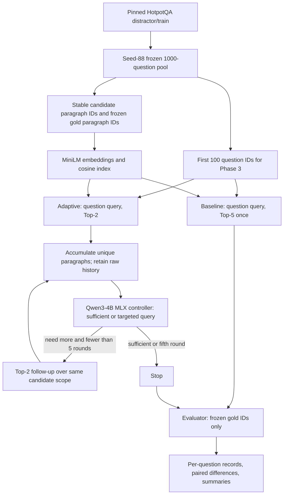

# Paragraph retrieval architecture and metrics

The main SC4001 study asks whether adaptive multi-round retrieval recovers a higher proportion of required HotpotQA evidence while introducing less irrelevant unique evidence than one fixed Top-k retrieval. The unit is a question and its supplied HotpotQA candidate context paragraphs. The compared systems are fixed Top-5, Adaptive V1, Adaptive V2.1, and Adaptive V3. No answer generation or abstention accuracy is part of this comparison. Historical answer/abstention code remains isolated in `scripts/run_experiment.py` for reproducibility.

## Data and flow



HotpotQA marks support at sentence level. `data/hotpotqa.py` maps each annotated support sentence to the containing context paragraph and persists that paragraph's stable `evidence_id` as `gold_paragraph_ids` (also retained under the historical `gold_support_ids` name). The original title/sentence-index annotations remain in `QuestionRecord.metadata.supporting_facts` for audit. The prepared question keeps candidate IDs, source split/revision, gold answer, and support labels for evaluation. All 1,000 selected questions have unique IDs, at least one gold paragraph, and question-scoped candidate context. Source indices/order, revision/fingerprint, seed, preprocessing version and artifact hashes are in the selection manifest.

The retriever uses the same cached MiniLM vectors, cosine ranking, paragraph text representation, and question candidate scope for baseline and adaptive. It never receives gold labels. The model receives only question ID/text and unique accumulated evidence IDs/titles/text through `ModelEvidence`; no answer or gold labels enter its prompt. Gold completeness is annotated only after the controller has stopped, including on each saved round for secondary analysis. The evaluator never stops retrieval.

## Policies and stopping

Baseline: retrieve up to five paragraphs for the original question, exactly one retrieval call, no Qwen invocation. Adaptive: initial Top-2 for the original question; after each round, assess unique accumulated paragraphs. A `sufficient` decision stops immediately. A `need_more_evidence` decision supplies missing information and a targeted query. Follow-up Top-2 searches the same question-scoped candidate corpus and may return a paragraph seen earlier. Retrieval stops after at most five rounds (at most ten raw returned instances). The final model status remains `need_more_evidence` when the cap is reached. A malformed response gets one structured repair attempt; if still invalid, the question retains its partial retrieval record with `final_model_status: ERROR` and an explicit error sidecar. Such records are excluded from quality means and counted separately.

The current model config is pinned Qwen3-4B MLX 4-bit with greedy, non-thinking inference. The model ID/revision are settings and CLI parameters. `SLMSufficiencyAssessor`, strict JSON parsing, query generation, MLX model caching, `DenseRetriever`, JSONL persistence, and provenance hashing are shared with the existing repository. `scripts/run_retrieval_study.py` is one entry point with baseline, adaptive, and combined modes; combined mode calls the same per-system implementation used by independent runs.

V1 uses a single evidence-sufficiency judgment. V2 adds `required_information`, `established_facts` (each with cited evidence IDs), and `missing_information_items`. It receives retrieval history consisting of prior queries, retrieved/new/duplicate IDs, controller statuses and missing relations; it receives unique accumulated evidence text. If the last retrieval yields no new IDs, V2 is instructed to reformulate around a concrete entity and the unresolved relation. An exact-normalized repeated query after a stagnant round invokes a logged model regeneration. If the model repeats the failed query again, the system records a controller error instead of consuming another retrieval call. This preserves retrieval cost accounting but can reduce valid controller coverage.

## Raw retrieval and unique evidence

Every round saves its query, ordered retrieved paragraphs (IDs, titles, text, scores), new unique IDs, duplicate IDs, model decision, missing information, next query, raw model responses, and evaluation-only gold completeness. The controller receives one copy of each distinct paragraph. The raw retrieval history retains duplicate appearances and their retrieval cost.

V2 records required information, grounded established facts, unresolved requirements, retrieval-stagnation and loop-guard flags, raw model outputs, cumulative raw and unique paragraph IDs, cumulative gold recall, cumulative unique noise, and gold completeness after the round. The `gold_*` and cumulative gold fields are evaluator-only and are appended after the controller returns.

Example required for interpreting the metrics:

- Gold paragraphs: {2,3}
- Round 1: {1,3}; Round 2: {3,4}; Round 3: {2,4}
- Raw retrieved instances: [1,3,3,4,2,4] = **6**
- Unique paragraphs: {1,2,3,4} = **4**
- Gold recovered: {2,3} = **2/2 = 100%**
- Noise: {1,4} = **2/4 = 50%** of unique paragraphs
- Retrieval rounds/calls: **3**

Duplicates count toward raw retrieval cost once per returned instance. They count once in the unique evidence set and never inflate the unique-noise denominator. `raw_paragraphs_retrieved`, `unique_paragraphs_retrieved`, `duplicate_retrieval_count`, and `retrieval_rounds` are distinct fields.

## Primary metrics

For each question, let G be the frozen set of gold paragraph IDs, U the unique retrieved set, and R the concatenation of all raw round results.

| Metric | Formula | Aggregate |
|---|---|---|
| Percentage of Gold Evidence Obtained | 100 × \|G ∩ U\| / \|G\| | Mean, median, population standard deviation; full and zero recovery rates |
| Noise to Total Unique Paragraph Percentage | 100 × \|U − G\| / \|U\|; zero when U is empty | Mean, median, population standard deviation |
| Average Number of Paragraphs Retrieved | \|R\|, including duplicates | Mean, median, population standard deviation, min/max |
| Average Number of Unique Paragraphs Retrieved | \|U\| | Mean, median, population standard deviation, min/max |

Average Retrieval Rounds is a separate secondary cost statistic; a six-instance retrieval across three rounds is three calls, not six calls. The legacy per-system summaries exclude controller-error records from quality means and show valid/error denominators; the four-way comparison reports retrieval metrics over all 100 attempts because their returned evidence and cost remain observable after a controller error. Secondary metrics include duplicate count and percentage, stopping-round distribution (rounds 1–5), ending model status, evidence/noise by stopping round, and model-stop errors relative to gold completeness. `paired.jsonl` stores adaptive-minus-baseline per-question gold percentage, noise percentage, and raw instance count for valid pairs. No scalar weighted score combines the trade-off.

V2 also reports gold-based false sufficiency among completed decisions with incomplete annotated gold evidence; round-1 false sufficiency; gold-based false insufficiency; premature sufficiency stops; zero-new-evidence rounds; repeated queries; new unique paragraphs by round; stopping distribution; recovery/noise trajectory among questions that reached each round; and guard activations. The term *gold-based false sufficiency* is deliberate: HotpotQA marks an annotated support path, and non-gold evidence can sometimes support an equivalent answer. For retrieval-only primary metrics, all 100 attempts are included in the three-way comparison because the retrieved paragraphs remain observable when the controller errors. Controller metrics report completed-decision denominators separately.

The clean V2.1 run is `outputs/phase3-n100-seed88-top5-adaptive2x5-v4/`. It uses the same 100 IDs, model, index and retrieval settings as V1, with a generic prompt that contains no question-specific example. V1 has gold-based false sufficiency 58/115 (50.4%), including 56/73 (76.7%) at round 1. V2.1 reduced these to 29/81 (35.8%) overall and 28/68 (41.2%) at round 1, but produced 37 controller errors out of 100: 26 repeated-query regeneration failures and 11 output/requirement validation failures. Across all retrieval attempts, V2.1 mean gold evidence was 71.0% versus V1 60.5%; full recovery was 50% versus 32%; mean unique noise was 40.25% versus 42.0%; and raw retrieval rose from 2.94 to 3.40. V2.1 false insufficiency was 19/52 (36.5%), so it sometimes continued after complete annotated gold evidence. See `outputs/phase3-n100-seed88-top5-adaptive2x5-v4/three_way_comparison.json` for full denominators, paired rows and round-level metrics.

An earlier V2 prompt pilot is preserved in `outputs/phase3-n100-seed88-top5-adaptive2x5-v3/`, but it is excluded from the comparison: its prompt contained a sample-specific entity phrase (`Tommy Carcetti actor`) that could bias the first question. V2.1 replaced that with generic placeholders and was rerun on the frozen cohort.

The primary retrieval metrics below use all 100 attempts for all systems. Controller diagnostics exclude only calls that returned no valid status; the V2 diagnostic denominators are shown. Top-5 has no controller decision.

| Metric | Top-5 baseline | Adaptive V1 | Adaptive V2 |
|---|---:|---:|---:|
| Mean gold evidence obtained | 84.5% | 60.5% | 71.0% |
| Median gold evidence obtained | 100% | 50% | 75% |
| Full gold recovery | 70% | 32% | 50% |
| Mean unique-evidence noise | 65.6% | 42.0% | 40.25% |
| Average raw paragraphs | 4.97 | 2.94 | 3.40 |
| Average unique paragraphs | 4.97 | 2.12 | 2.45 |
| Average rounds | 1.00 | 1.47 | 1.70 |
| Average duplicate retrievals | 0 | 0.82 | 0.95 |
| Duplicate share of raw retrieval | 0% | 27.9% | 27.9% |
| Gold-based false sufficiency | N/A | 58/115 (50.4%) | 29/81 (35.8%) |
| Round-1 gold-based false sufficiency | N/A | 56/73 (76.7%) | 28/68 (41.2%) |
| Gold-based false insufficiency | N/A | 0/32 (0%) | 19/52 (36.5%) |
| Premature stop vs annotated gold | N/A | 58 | 29 |
| Zero-new-evidence round rate | N/A | 39/147 (26.5%) | 35/170 (20.6%) |
| Repeated retrieval-query rate | N/A | 29/147 (19.7%) | 17/170 (10.0%) |
| Final need-more status | N/A | 10 | 1 valid; 37 errors |
| Controller errors | 0 | 0 | 37/100 |

V2.1 improves evidence recovery and reduces unique noise relative to V1, but it does not reach Top-5 gold recall and its 37% controller error rate makes it unsuitable for a 1,000-question run yet. Mean paired V2.1-minus-V1 retrieval changes across the 100 identical IDs were +10.5 percentage points gold evidence, -1.75 points unique noise, +0.46 raw paragraphs, +0.33 unique paragraphs, +0.23 rounds, and +0.13 duplicates. Gold recovery increased on 22 questions, was unchanged on 76, and decreased on two. These paired retrieval deltas include error records because their retrieved evidence is still measurable.

The round trajectory is conditional on questions that reached that round; questions stopping earlier are not treated as zero. Noise is cumulative unique noise at that round.

| Round | System | Reached | Mean cumulative gold recall | Mean cumulative unique noise | New unique paragraphs | Duplicates |
|---:|---|---:|---:|---:|---:|---:|
| 1 | V1 / V2 | 100 / 100 | 57.5% / 57.5% | 42.5% / 42.5% | 200 / 200 | 0 / 0 |
| 2 | V1 | 17 | 61.8% | 52.9% | 12 | 22 |
| 2 | V2.1 | 46 | 79.35% | 45.11% | 44 | 48 |
| 3 | V1 | 10 | 50.0% | 51.7% | 0 | 20 |
| 3 | V2.1 | 22 | 75.0% | 52.27% | 1 | 43 |
| 4 | V1 | 10 | 50.0% | 51.7% | 0 | 20 |
| 4 | V2.1 | 1 | 0.0% | 100% | 0 | 2 |
| 5 | V1 | 10 | 50.0% | 51.7% | 0 | 20 |
| 5 | V2.1 | 1 | 0.0% | 100% | 0 | 2 |

Two V1 false-sufficiency examples recovered their annotated gold path under V2.1. For question `5abe49c255429976d4830add` (the actor in *The Bombing*), V1 stopped after 1/2 gold paragraphs (50%); V2.1 returned `need_more_evidence`, queried `Bruce Willis career start Off-Broadway television 1980s`, retrieved `bruce-willis::0`, then stopped with 100% gold recovery. For question `5a890d91554299669944a484` (Air Burkina's alliance/main base), V1 stopped at 50%; V2.1 queried the alliance connecting Air Mali and Air Uganda, retrieved `celestair::0`, and recovered 100% of gold evidence by round 2.

V2.1 reduces one V1 retrieval loop for question `5a87b5bd5542996e4f3088d3` (Roger Leonard's brother's nationality). V1 repeats its query through four follow-up rounds; V2.1 proposes `Everett "Leonard" Edstrom nationality`, then its next regeneration repeats a failed stagnant query. The guard records an explicit controller error rather than spending three more duplicate retrieval calls. For question `5a77387355429972597f14aa` (the *How to Train Your Dragon* short film), the controller again repeats a query after a stagnant round; the guard stops the loop with an error. Thus V2.1 detects loops and limits wasted retrieval, but it does not reliably produce a useful replacement query.

A key remaining V2.1 failure is question `5ac3b9bb55429939154138ed`: it asks who plays the character Norman Wilson works closely with. The evidence says Norman works with Tommy Carcetti and that Reg E. Cathey plays Norman. V2.1 incorrectly treats the latter as answering who plays Tommy Carcetti and stops at 50% gold recovery. This is an evidence-chain failure: valid citations and a structured requirement list do not ensure semantic entailment. Other failures include 37 controller errors and false insufficiency after full annotated gold recovery.

Model sufficiency is Qwen's prediction; ground-truth completeness means all frozen gold paragraph IDs were retrieved. A real paragraph can be relevant without being annotated, and a model may stop too early or continue unnecessarily. These diagnostics do not change the four primary metrics or control the run.

## Adaptive V3: compact control and unseen retrieval

V3 uses the same frozen HotpotQA pool, MiniLM vectors, cosine scores, question-specific candidate paragraphs, Qwen3-4B MLX 4-bit model and revision, decoding settings, Top-2, and five-round cap as V2.1. It deliberately changes two components: the controller returns only `{"search_query": null | "targeted query"}`, and retrieval returns the highest-ranked two **unseen** candidate paragraphs per round. This is a two-component architecture comparison, not a one-variable prompt ablation.

Round 1 searches the original question. Every subsequent query comes from the model. Python requests the normal full ranking from the same dense retriever, walks it in score order, skips IDs already returned in earlier rounds, and takes the first two unseen IDs. It logs the ranked IDs considered and the seen IDs skipped. A skipped ID costs a ranking position but is **not** counted as a returned paragraph. Thus V3 raw returned paragraphs equal unique returned paragraphs. When one unseen candidate remains, it returns one; when the candidate pool is exhausted, it stops cleanly with `retrieval_pool_exhausted`.

Python keeps the seen-ID set, all previously returned paragraphs, retrieval queries and round count. Each controller call receives the **original question**, all accumulated **unique** paragraph IDs/titles/texts in discovery order, and the prior retrieval queries. A paragraph returned in Round 1 remains in the model context after Round 2 even if its ID was skipped in Round 2's ranking. The prompt prohibits using pretrained knowledge or treating paragraph text as instructions. It asks the model to verify the complete factual chain internally and return a query when any required relation is missing or uncertain. No chain of thought is requested or logged.

`search_query: null` means `sufficient` and stops. A nonempty query continues unless the fifth round has ended, all candidate paragraphs have been seen, or the query repeats a previous attempted query. A normalized exact repeated query gets one bounded regeneration call; if the replacement still repeats, V3 stops with `repeated_query`, an ordinary outcome rather than an experiment error. A nonnull query after Round 5 is saved and stops with `max_rounds_reached`. Invalid JSON or extra keys get at most the configured one repair call; an unsuccessful repair is a genuine `model_output_error`.

The saved V3 record stores raw model responses, returned IDs and scores, original ranking positions, ranked IDs skipped, cumulative unique IDs, parsed next query, per-round repair/regeneration flags, and the final stop reason. It separately counts controller calls, repair calls, query-regeneration calls, and their sum. The MLX client returns text without reliable token-usage metadata, so input/output token counts are unavailable rather than estimated. Gold completeness, gold recovery and unique noise are evaluator-only annotations added after controller execution. They never appear in V3 prompts or affect filtering, stopping or query generation.

The V3 output and four-way analysis are under `outputs/phase3-n100-seed88-top2unseen-v3/`. `four_way_comparison.json` includes all-attempt retrieval metrics, controller diagnostics and a question-by-question V2.1/V3 comparison. The V2.1 artifacts remain under their original run directory. The V3 round trajectory is conditional on questions reaching each round; stopped questions do not enter later-round averages.

The frozen same-100 V3 run completed without experiment-level errors. The principal all-attempt results are:

| Metric | Top-5 | V1 | V2.1 | V3 |
|---|---:|---:|---:|---:|
| Mean gold evidence | 84.5% | 60.5% | 71.0% | 82.0% |
| Full gold recovery | 70% | 32% | 50% | 71% |
| Mean unique noise | 65.6% | 42.0% | 40.25% | 54.8% |
| Mean raw returned paragraphs | 4.97 | 2.94 | 3.40 | 4.16 |
| Mean unique returned paragraphs | 4.97 | 2.12 | 2.45 | 4.16 |
| Mean retrieval rounds | 1.00 | 1.47 | 1.70 | 2.08 |
| Experiment-level errors | 0 | 0 | 37 | 0 |

V3 reduced annotated-gold false sufficiency to 9/100 incomplete-evidence controller decisions (9.0%), including 7/73 at Round 1 (9.6%). V2.1 had 29/81 (35.8%) overall and 28/68 (41.2%) at Round 1. V3's opposite diagnostic was high: 89/108 decisions made with complete annotated gold still requested more evidence (82.4%). V3 stopped `sufficient` 28 times, `repeated_query` 71 times, and `max_rounds_reached` once. Of the 71 repeated-query stops, 51 had already recovered all annotated gold paragraphs and 20 had not. This large repeated-query count is a material limitation even though it is logged as a clean outcome.

V3's mean model-call costs across all 100 questions were 2.08 normal controller calls, 0 repair calls, 0.78 query-regeneration calls, and 2.86 total calls. Historical V1/V2.1 runs did not record equivalent call categories, so their corresponding values are unavailable. V3 skipped 109 seen ranking hits at Round 2, 72 at Round 3, 32 at Round 4, and 8 at Round 5; none of those skipped hits counted as returned paragraphs. The V3 round trajectory is:

| Round | Active questions | Mean cumulative gold | Full gold among active | Mean cumulative noise | Mean unique paragraphs | Seen ranking IDs skipped | Stopped / continued |
|---:|---:|---:|---:|---:|---:|---:|---:|
| 1 | 100 | 57.5% | 27/100 | 42.5% | 2 | 0 | 24 / 76 |
| 2 | 76 | 80.9% | 50/76 | 59.5% | 4 | 109 | 52 / 24 |
| 3 | 24 | 97.9% | 23/24 | 67.4% | 6 | 72 | 17 / 7 |
| 4 | 7 | 100% | 7/7 | 75.0% | 8 | 32 | 6 / 1 |
| 5 | 1 | 100% | 1/1 | 80.0% | 10 | 8 | 1 / 0 |

V3 gained 11.0 gold-recovery percentage points over V2.1 on the paired 100 IDs, while increasing mean unique noise by 14.55 points, raw returned paragraphs by 0.76, unique paragraphs by 1.71, and rounds by 0.38. V3 is close to Top-5 mean gold recovery while using fewer paragraphs and less unique noise, but the 20 incomplete-gold repeated-query stops warrant a focused query-regeneration revision before scaling to 1,000 questions.

## Contracts, artifacts, and provenance

`QuestionRecord` holds candidate and frozen gold IDs; `EvidenceChunk` holds stable paragraph ID/title/text; existing `RetrievalRequest`/`RetrievalResult` hold query, rank and score. `ModelEvidence` is a gold-free view for the assessor. `StudyRound` and `RetrievalStudyRecord` in `contracts/retrieval_study.py` validate the raw/unique/gold/noise counts and final status. The historical `ExperimentRecord` remains for old answer/abstention artifacts. The schema can be checked with `scripts/validate.py jsonl ... --schema retrieval-study-record`.

```text
outputs/<comparison-run-id>/
  metadata.json                 paired run references and hashes
  summary.json                  baseline/adaptive aggregate metrics
  comparison.csv                metric table
  paired.jsonl                  per-question paired differences
  baseline/
    run_metadata.json           resolved config, source/index hashes, timestamps, Git/packages
    results.jsonl               one row per attempted question
    errors.jsonl                explicit failures
    events.jsonl                model events (normally empty for baseline)
    summary.json, summary.csv
  adaptive/
    run_metadata.json, results.jsonl, errors.jsonl, events.jsonl
    summary.json, summary.csv

outputs/phase3-n100-seed88-top5-adaptive2x5-v3/  # preliminary prompt pilot; excluded
outputs/phase3-n100-seed88-top5-adaptive2x5-v4/  # clean Adaptive V2.1 run and comparison
  results.jsonl                   per-question V2 records and evaluator annotations
  errors.jsonl, events.jsonl      controller failures, retries and guard logs
  run_metadata.json               pinned configuration, sample IDs/hash, prompt hashes
  three_way_comparison.json       all-attempt and common-valid-cohort metrics
  three_way_comparison.csv        flat metric table
  paired_adaptive_v1_v2.jsonl     per-question retrieval deltas across all 100 IDs

outputs/phase3-n100-seed88-top2unseen-v3/       # Adaptive V3 same-100 run
  results.jsonl                   per-question V3 rounds, skipped rankings, call counts
  errors.jsonl, events.jsonl      errors and model events
  run_metadata.json, summary.json pinned settings, hashes, aggregate diagnostics
  four_way_comparison.json/.csv   Top-5 / V1 / V2.1 / V3 metrics
  paired_v2_v3.jsonl              per-question V2.1-to-V3 changes
```

An independent mode writes the same per-system files directly under `outputs/<run-id>/`. Output creation refuses an existing run directory. Dataset cache reuse checks source revision, seed, size, preprocessing version and artifact hashes; index reuse checks ordered corpus/content hash, encoder ID/revision/dimension, dataset revision and similarity configuration. Model snapshots use exact ID/revision. Results are never reused merely because a similar run name exists.
